# Pascal VOC Nesne Tespiti — YOLO26n Fine-tuning

Bu rapor, Computer Vision dersi kapsamında Pascal VOC 2007 + 2012 veri seti üzerinde
Ultralytics YOLO26n modelinin fine-tune edilmesini, test değerlendirmesini, inference
hızlarını ve Gradio uygulamasını içerir. Rapordaki tüm sayılar `results/` altındaki
dosyalarda kayıtlı gerçek çalıştırma çıktılarıdır.

## Ödev 9. Maddesi — Proje Raporu Şablonu

| Alan | Açıklama / Öğrenci yanıtı |
|---|---|
| Project Title | Pascal VOC Nesne Tespiti — YOLO26n Fine-tuning |
| Problem / Task | Object detection (nesne tespiti): 20 VOC sınıfında bounding box + sınıf tahmini |
| Dataset | Pascal VOC 2007 + 2012, 20 sınıf; train 14.893, val 1.655, test 4.952 görüntü |
| Dataset URL | http://host.robots.ox.ac.uk/pascal/VOC/ |
| Model Architecture | Ultralytics YOLO26n (COCO-pretrained, end-to-end/NMS-free); C3k2 backbone, SPPF + C2PSA, PAN-FPN neck, decoupled Detect head; 2,51M parametre, 5,9 GFLOPs |
| Input Size | 640 × 640 |
| Hyperparameters | 48 epoch, batch 16, lr0 0.001, lrf 0.01, AdamW betas (0.9, 0.999), weight decay 0.0005, warmup 1 epoch, cos_lr, close_mosaic 10, seed 42, AMP |
| Optimizer | AdamW (lr=0.001, betas=(0.9, 0.999), weight decay 0.0005) |
| Activation / Output Function | Gizli katmanlarda SiLU; sınıf çıktısında sigmoid (BCEWithLogits); box çıktısı doğrudan decode + L1/CIoU (YOLO26'da DFL yok) |
| Loss Function | E2ELoss: one-to-many + one-to-one dallar için BCEWithLogitsLoss (sınıf) + CIoU ve L1 (box); TaskAlignedAssigner |
| Evaluation Metrics | mAP@0.5, mAP@0.5:0.95, precision, recall, sınıf bazında AP/P/R, eşleşen kutularda ortalama IoU, inference süresi/FPS |
| Training Environment | Ubuntu 22.04, NVIDIA RTX 4050 Laptop GPU (6.141 MiB VRAM), driver 580.178.04, CUDA 12.4 (PyTorch), Python 3.10.12, Ultralytics 8.4.214, PyTorch 2.6.0+cu124 |
| Best Performance | Test mAP@0.5 = 0.801, mAP@0.5:0.95 = 0.593, precision = 0.740, recall = 0.779 (conf = 0.25) |
| Inference Time | GPU 8.63 ms/görüntü (115.8 FPS); CPU 36.00 ms/görüntü (27.8 FPS), 640×640, batch 1 |
| Deployment Technology | Gradio 6.32.0 (Python) |
| Repository | https://github.com/Enes004/MachineLearning/tree/main/CNN_YOLO_Odev2 |

## 1. Amaç

Amaç, açık kaynaklı bir veri seti üzerinde bilgisayarlı görü problemi için bir derin öğrenme
modeli geliştirmek, başarımını problem türüne uygun metriklerle değerlendirmek ve modeli
çalışan bir uygulama olarak sunmaktır. Bu projede problem **nesne tespiti (object detection)**
olarak seçilmiş; Pascal VOC 2007 + 2012 veri seti ve YOLO26n modeli kullanılmıştır.

## 2. Görev (Task)

Görev, bir görüntüdeki 20 VOC sınıfına ait nesneleri bulmak ve her nesne için
`(sınıf, güven skoru, x1, y1, x2, y2)` üretmektir. Problem türü nesne tespitidir; sınıflandırma
veya segmentasyondan farklı olarak hem **sınıf** hem **konum** çıktısı gerekir. Değerlendirme
için mAP, precision, recall ve IoU kullanılmıştır.

## 3. Model (Architecture)

Kullanılan model: **Ultralytics YOLO26n** (`yolo26n.pt`). Kurulu Ultralytics 8.4.214 sürümünde
bulunan en güncel nano boyutlu detection modelidir. COCO üzerinde eğitilmiş ağırlıklardan
VOC'nin 20 sınıfına fine-tune edilmiştir.

- **Backbone:** Conv + C3k2 blokları, SPPF ve C2PSA ile özellik çıkarımı.
- **Neck:** P3/P4/P5 özelliklerini birleştiren PAN-FPN tarzı top-down/bottom-up yol.
- **Head:** Decoupled detection head. YOLO26 **end-to-end** çalışır: eğitimde one-to-many ve
  one-to-one iki dal, çıkarımda one-to-one dal kullanılır; bu sayede NMS gerekmez.
- **Boyut:** Eğitim özeti 260 katman, **2.511.600 parametre**, **5,9 GFLOPs** (640×640).
- VOC için sınıf sayısı `nc=20`; COCO'daki 80 sınıf başlığı isim eşleşmesiyle 14 sınıf için
  aktarıldı, kalan sınıflar rastgele başlatıldı (Ultralytics "Remapped 14/20 cls head rows").

Alternatifler: Faster R-CNN (two-stage, yavaş), YOLOv8n/YOLO11n (daha eski nano), RT-DETR
(transformer, ağır). 6 GB VRAM ve ~2 saatlik eğitim bütçesi nedeniyle nano model seçildi.

## 4. Veri Seti ve Split

- **Kaynak:** Pascal VOC 2007 + 2012, 20 sınıf (aeroplane, bicycle, bird, boat, bottle, bus,
  car, cat, chair, cow, diningtable, dog, horse, motorbike, person, pottedplant, sheep, sofa,
  train, tvmonitor).
- **Veri seti URL:** http://host.robots.ox.ac.uk/pascal/VOC/ (VOC2007 ve VOC2012 indirme
  sayfaları). Kullanılan arşivler: `VOCtrainval_06-Nov-2007.zip`,
  `VOCtest_06-Nov-2007.zip`, `VOCtrainval_11-May-2012.zip`.
- **Dönüştürme:** VOC XML etiketleri YOLO formatına (`class cx cy w h`, normalize) çevrildi.
- **Split:** VOC2007 trainval + VOC2012 trainval birleşimi, `seed=42` ile rastgele karıştırıldı
  ve %90/%10 ayrıldı. Yıllar arasında byte-identical **3 kopya** çıkarıldı; 16.548 benzersiz
  görüntü kaldı.
- **Test:** VOC2007 test (4.952 görüntü). Eğitim ve hiperparametre seçimi sırasında
  **hiç kullanılmadı**; doğruluk metrikleri yalnızca en sonda bir kez hesaplandı.

| Split | Görüntü | Nesne | Nesne/görüntü | Boş görüntü | Difficult nesne |
|---|---:|---:|---:|---:|---:|
| train | 14.893 | 42.577 | 2,86 | 0 | 6.435 |
| val | 1.655 | 4.639 | 2,80 | 0 | 730 |
| test | 4.952 | 14.976 | 3,02 | 0 | 2.944 |

Sınıf dağılımı belirgin şekilde dengesizdir: train'de person 14.042, chair 3.942, car 3.616
nesne; train 885 ve bus 813 nesne. Test'te de person 5.227 ile baskındır. Bu nedenle mAP
sınıf bazında ayrıca raporlanmıştır.

**Not:** `difficult=1` nesneler YOLO etiketlerinde normal nesne olarak tutulmuştur. Standart
VOC protokolünde bu nesneler değerlendirmede yok sayılır; burada dahil edildiği için
raporlanan metrikler standart protokole göre daha katıdır.

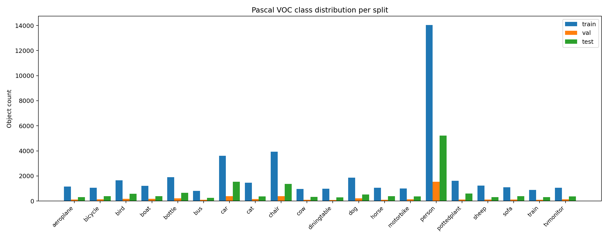

## 5. Model Ayarları ve Eğitim

Tüm hiperparametreler `configs/train_config.yaml` dosyasındadır; Ultralytics'in `auto`
optimizer/LR seçimi kullanılmamıştır.

| Hiperparametre | Değer | Kısa gerekçe |
|---|---|---|
| Model | yolo26n.pt | Kurulu sürümün en güncel nano modeli, COCO-pretrained |
| Input size | 640×640 | Pretrained ile uyumlu; doğruluk/hız/VRAM dengesi |
| Epoch | 48 | Tam eğitimde ortalama 2.22 dk/epoch; ~2 saat bütçesi |
| Batch size | 16 | 640'ta ~2,6 GB VRAM; 6 GB karta güvenli |
| Optimizer | AdamW | Transfer learning için stabil, parametre bazlı adaptif LR |
| lr0 | 0.001 | AdamW için ölçülü başlangıç; pretrained özellikleri korur |
| lrf | 0.01 | Son LR = 0,0001; ince ayar için küçük |
| Momentum | 0.9 | AdamW beta1 standardı |
| Weight decay | 0.0005 | Regularization |
| Warmup | 1 epoch | İlk epoch'ta LR'yi kademeli açma |
| LR schedule | cosine | Son epoch'larda yumuşak düşüş |
| close_mosaic | 10 | Son 10 epoch gerçek görüntü dağılımına yaklaşma |
| Seed | 42 | Tekrarlanabilirlik |
| AMP | Açık | VRAM/hız tasarrufu |

**Optimizer seçimi:** AdamW, her parametre için adaptif öğrenme oranı kullandığı ve weight
decay'i gradyan güncellemesinden ayrı uyguladığı için transfer learning/fine-tuning'de
stabildir. COCO'dan gelen ağırlıkların korunması ve yeni 20 sınıflık başlığın makul hızda
öğrenmesi için `lr0=0.001` seçildi. Ultralytics'in `auto` seçimi kullanılmadı; optimizer ve
learning rate açıkça belirlendi.

**Aktivasyon ve çıktı (kaynaktan doğrulandı):** `ultralytics/nn/modules/conv.py` içinde
`Conv.default_act = nn.SiLU()`; gizli katmanlarda SiLU kullanılır. `Detect._inference`
içinde sınıf skorları `x["scores"].sigmoid()` ile olasılığa çevrilir. Softmax yoktur; her
sınıf bağımsız sigmoid'dir (multi-label). Eğitimde sınıf logit'lerine `BCEWithLogitsLoss`
uygulanır.

**Loss (kaynaktan doğrulandı):** `ultralytics/utils/loss.py`:
- Sınıf: `nn.BCEWithLogitsLoss`.
- Box: `BboxLoss` içinde **CIoU** + **L1**. YOLO26'da `reg_max=1` olduğu için **DFL yoktur**;
  eski YOLO'lardaki Distribution Focal Loss kaldırılmıştır.
- Atama: `TaskAlignedAssigner` (sınıf + IoU hizalaması).
- YOLO26 `E2ELoss`, one-to-many ve one-to-one dalların kayıplarını ağırlıklı toplar
  (one-to-many ağırlığı eğitim boyunca 0,8'den 0,1'e düşer).

**Eğitim süreci:** Önce verinin %5'iyle 1 epoch'luk smoke test çalıştırıldı
(`results/smoke_time.json`, 37.5 s); hata alınmadı. Tam eğitim başlatıldıktan sonra
ölçülen ortalama 2.22 dk/epoch hızıyla 48 epoch çalıştırıldı. Eğitim `nohup` ile
arka planda çalıştırıldı; log `results/train.log` dosyasındadır. Toplam wall-clock süre
**01:46:21** (`results/train_time.json`). En iyi ağırlık `weights/best.pt` olarak
kopyalandı.

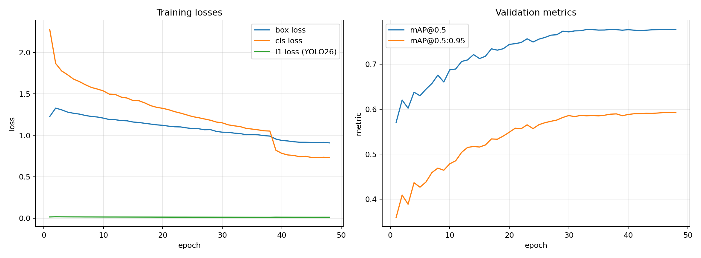

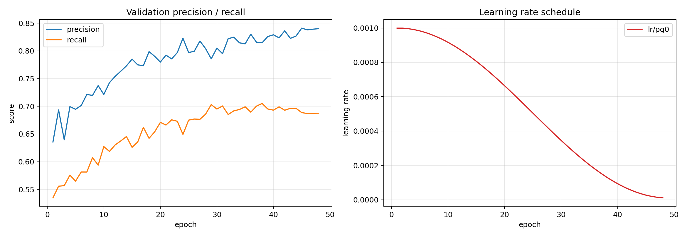

## 6. Performans Değerlendirmesi

Test kümesi üzerinde doğruluk metrikleri yalnızca bir kez hesaplandı. Ultralytics `val()` ile
COCO tarzı AP hesaplandı; ayrıca sabit `conf=0.25`, `IoU=0.5` ile greedy eşleştirme yapılarak
precision, recall ve eşleşen kutuların ortalama IoU'su hesaplandı. Hız ölçümünde test
görüntülerinden 200'ü yalnızca süre için kullanıldı; hiçbir ayar test sonucuna göre yapılmadı.

| Metrik | Değer |
|---|---:|
| Test mAP@0.5 | 0.801 |
| Test mAP@0.5:0.95 | 0.593 |
| Precision (conf=0.25, IoU=0.5) | 0.740 |
| Recall (conf=0.25, IoU=0.5) | 0.779 |
| F1 (conf=0.25, IoU=0.5) | 0.759 |
| TP / FP / FN | 11670 / 4104 / 3306 |
| Eşleşen kutu sayısı | 11670 |
| Ortalama eşleşen IoU | 0.853 |
| Medyan eşleşen IoU | 0.890 |
| Ultralytics P / R (best-F1 eşiği) | 0.819 / 0.722 |

### Sınıf bazında sonuçlar

| Sınıf | AP50 | AP50-95 | P | R | F1 | IoU | TP | FP | FN |
|---|---:|---:|---:|---:|---:|---:|---:|---:|---:|
| aeroplane | 0.906 | 0.684 | 0.890 | 0.855 | 0.872 | 0.870 | 266 | 33 | 45 |
| horse | 0.900 | 0.716 | 0.832 | 0.838 | 0.835 | 0.885 | 331 | 67 | 64 |
| cat | 0.896 | 0.752 | 0.824 | 0.870 | 0.846 | 0.912 | 322 | 69 | 48 |
| train | 0.896 | 0.700 | 0.834 | 0.848 | 0.841 | 0.880 | 256 | 51 | 46 |
| person | 0.871 | 0.605 | 0.756 | 0.837 | 0.795 | 0.840 | 4376 | 1410 | 851 |
| cow | 0.870 | 0.612 | 0.789 | 0.818 | 0.803 | 0.849 | 269 | 72 | 60 |
| car | 0.867 | 0.662 | 0.785 | 0.836 | 0.810 | 0.866 | 1288 | 352 | 253 |
| motorbike | 0.867 | 0.625 | 0.787 | 0.810 | 0.798 | 0.855 | 299 | 81 | 70 |
| dog | 0.862 | 0.675 | 0.801 | 0.828 | 0.814 | 0.888 | 439 | 109 | 91 |
| bus | 0.840 | 0.729 | 0.778 | 0.772 | 0.775 | 0.920 | 196 | 56 | 58 |
| bicycle | 0.838 | 0.621 | 0.803 | 0.787 | 0.795 | 0.865 | 306 | 75 | 83 |
| bird | 0.800 | 0.542 | 0.785 | 0.724 | 0.753 | 0.846 | 417 | 114 | 159 |
| tvmonitor | 0.778 | 0.600 | 0.743 | 0.745 | 0.744 | 0.883 | 269 | 93 | 92 |
| sheep | 0.761 | 0.557 | 0.703 | 0.768 | 0.734 | 0.861 | 239 | 101 | 72 |
| sofa | 0.744 | 0.597 | 0.581 | 0.783 | 0.667 | 0.893 | 310 | 224 | 86 |
| diningtable | 0.736 | 0.571 | 0.656 | 0.739 | 0.695 | 0.881 | 221 | 116 | 78 |
| boat | 0.683 | 0.418 | 0.655 | 0.667 | 0.661 | 0.807 | 262 | 138 | 131 |
| chair | 0.653 | 0.433 | 0.630 | 0.630 | 0.630 | 0.836 | 865 | 508 | 509 |
| bottle | 0.652 | 0.423 | 0.690 | 0.603 | 0.643 | 0.825 | 396 | 178 | 261 |
| pottedplant | 0.595 | 0.331 | 0.572 | 0.579 | 0.576 | 0.799 | 343 | 257 | 249 |

P = precision, R = recall, IoU = eşleşen kutuların ortalama IoU'su. AP değerleri Ultralytics `val()` (conf=0.001), P/R/F1 ve TP/FP/FN ise conf=0.25, IoU=0.5 eşleştirmesi sonucudur.

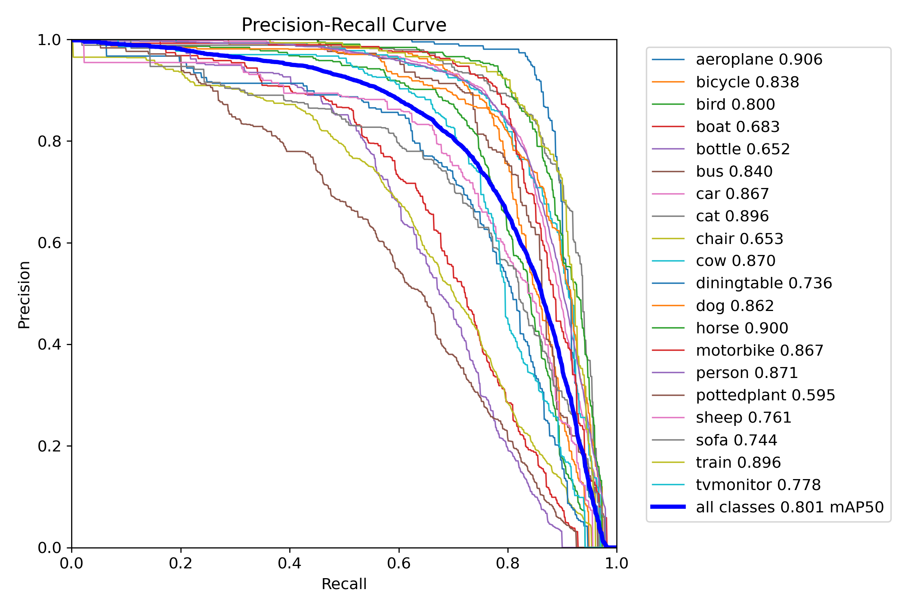

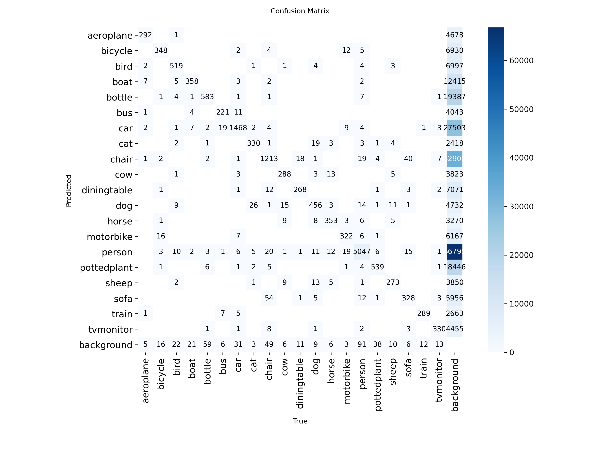

### Test görüntüleri üzerinde örnek tahminler

Aşağıdaki 8 görüntü, test kümesinden otomatik seçilmiştir: 4 yüksek F1 (iyi örnek) ve
4 düşük F1 (kötü örnek). Kutular tahminleri, başlıklar TP/FP/FN ve F1 değerlerini gösterir.

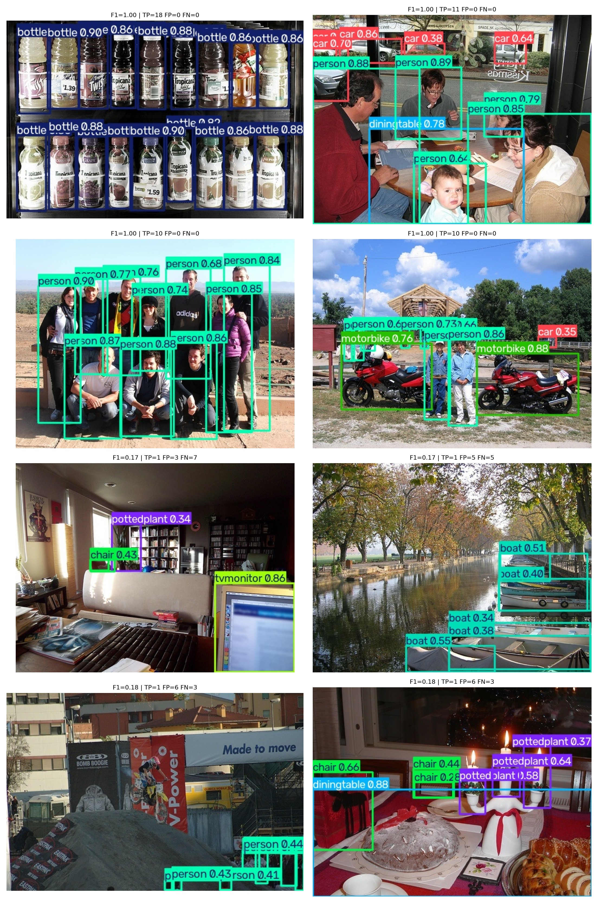

### Eğitim süresi

- Smoke test: 37.5 s (verinin %5'i, 1 epoch).
- Tam eğitim: **01:46:21** wall-clock, 48 epoch, RTX 4050 Laptop.
- Eğitim sırasında GPU belleği ~2,6 GB; AMP açık.

### Inference süresi ve FPS

Test kümesinden 200 görüntü üzerinde, 10 warmup sonrası, batch=1, 640×640:

| Cihaz | Preprocess (ms) | Inference (ms) | Postprocess (ms) | Toplam (ms) | FPS |
|---|---:|---:|---:|---:|---:|
| GPU (RTX 4050 Laptop) | 0.75 | 5.89 | 0.60 | 8.63 | 115.8 |
| CPU | 0.96 | 32.97 | 0.49 | 36.00 | 27.8 |

GPU ölçümü CUDA senkronizasyonlu Ultralytics profiler'ı ile alınmıştır. Detaylar
`results/inference_time.json` dosyasındadır.

## 7. Uygulama (Deployment)

Gradio uygulaması (`app.py`) şunları sunar:

- Görüntü yükleme (JPG/PNG/WEBP/HEIC); `pillow-heif` ile HEIC desteği.
- Telefon fotoğrafları için EXIF yön düzeltmesi (`ImageOps.exif_transpose`).
- Confidence threshold slider'ı.
- Kutuları çizilmiş çıktı görüntüsü.
- Tespit tablosu: sınıf, güven skoru, x1/y1/x2/y2.
- Preprocess / inference / postprocess ve toplam inference süresi, FPS.

Çalıştırma:

```bash
env -u PYTHONPATH .venv/bin/python app.py
# http://127.0.0.1:7860
```

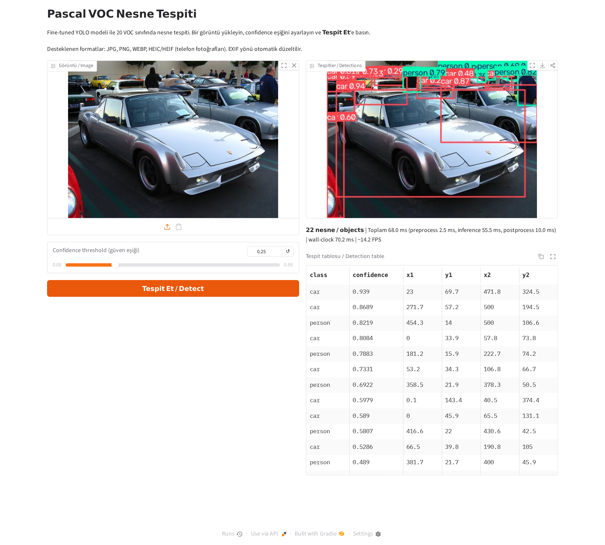

## 8. Gerçek Görüntülerle Test ve Değerlendirme

Aşağıdaki tablo, telefonla çekilen 5 fotoğraf üzerinde modelin fotoğraf bazında tahmin sayılarını gerçek sayılarla karşılaştırır. `doğru` = min(tahmin, gerçek); `kaçırılan` = max(gerçek - tahmin, 0); `yanlış` = max(tahmin - gerçek, 0). Confidence eşiği 0.25; sınıf bazında ayrıntılar her fotoğrafın altındadır. Karşılaştırma kutu eşleştirmesi değil, sınıf başına sayı karşılaştırmasıdır.

| Fotoğraf | Doğru | Kaçırılan | Yanlış | Precision | Recall | F1 |
|---|---:|---:|---:|---:|---:|---:|
| foto1.jpg | 3 | 10 | 1 | 0.750 | 0.231 | 0.353 |
| foto2.jpg | 2 | 0 | 0 | 1.000 | 1.000 | 1.000 |
| foto3.jpg | 3 | 7 | 0 | 1.000 | 0.300 | 0.462 |
| foto4.jpg | 2 | 1 | 0 | 1.000 | 0.667 | 0.800 |
| foto5.jpg | 0 | 0 | 1 | 0.000 | yok | yok |

### Fotoğraflar ve tahminler

**foto1.jpg** — Not: kütüphane, iç mekân, selfie; kalabalık sahne, chair/table sayıları yaklaşık; ikinci kişi arka planda küçük (kırmızı tişörtlü)

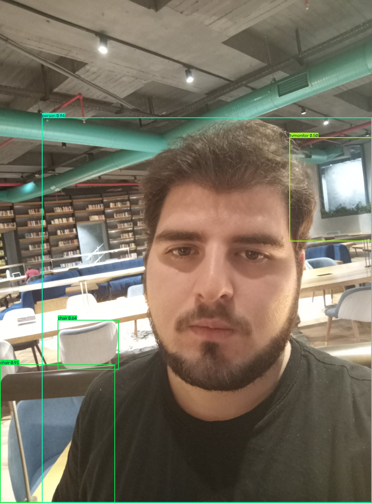

| Sınıf | Tahmin | Gerçek | Doğru | Kaçırılan | Yanlış | Ort. güven |
|---|---:|---:|---:|---:|---:|---:|
| chair | 2 | 6 | 2 | 4 | 0 | 0.774 |
| diningtable | 0 | 3 | 0 | 3 | 0 | yok |
| person | 1 | 2 | 1 | 1 | 0 | 0.939 |
| sofa | 0 | 2 | 0 | 2 | 0 | yok |
| tvmonitor | 1 | 0 | 0 | 0 | 1 | 0.497 |

Tek görüntü çıkarım süresi: 2062.64 ms (ilk çalıştırma; model warmup dahil, ortalama hız için benchmark geçerlidir).

**foto2.jpg** — Not: akşamüstü, park; kişi ve kedi iç içe (örtüşme); arka planda çok uzakta 2 küçük insan var (sayılmadı)

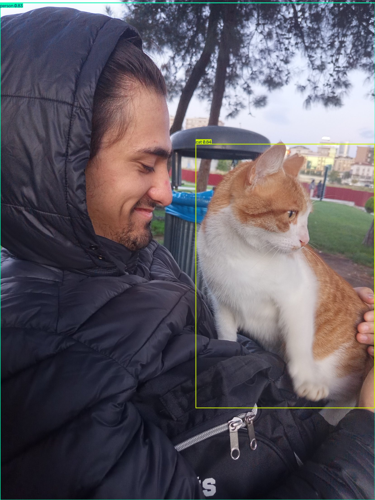

| Sınıf | Tahmin | Gerçek | Doğru | Kaçırılan | Yanlış | Ort. güven |
|---|---:|---:|---:|---:|---:|---:|
| cat | 1 | 1 | 1 | 0 | 0 | 0.844 |
| person | 1 | 1 | 1 | 0 | 0 | 0.833 |

Tek görüntü çıkarım süresi: 17.63 ms.

**foto3.jpg** — Not: gece otopark, cam arkasından çekilmiş, bulanık, yansımalı; araçlar iç içe, sayı yaklaşık; soldaki kişi hareketten bulanık

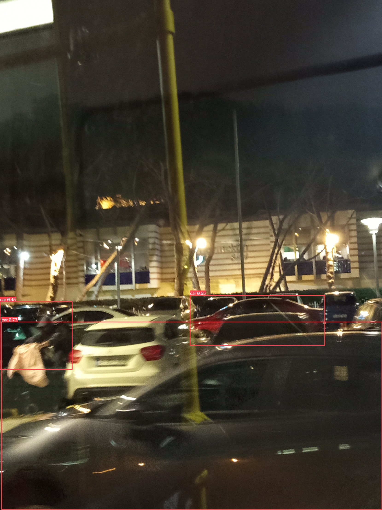

| Sınıf | Tahmin | Gerçek | Doğru | Kaçırılan | Yanlış | Ort. güven |
|---|---:|---:|---:|---:|---:|---:|
| car | 3 | 9 | 3 | 6 | 0 | 0.623 |
| person | 0 | 1 | 0 | 1 | 0 | yok |

Tek görüntü çıkarım süresi: 16.51 ms.

**foto4.jpg** — Not: gece, bahçe, karanlık; sağ üstteki ikinci sandalye kısmi; arka planda çok uzakta küçük araba ve insan var (sayılmadı)

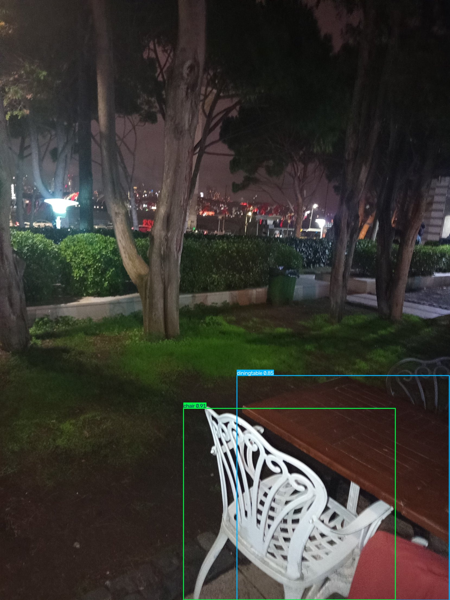

| Sınıf | Tahmin | Gerçek | Doğru | Kaçırılan | Yanlış | Ort. güven |
|---|---:|---:|---:|---:|---:|---:|
| chair | 1 | 2 | 1 | 1 | 0 | 0.913 |
| diningtable | 1 | 1 | 1 | 0 | 0 | 0.850 |

Tek görüntü çıkarım süresi: 16.77 ms.

**foto5.jpg** — Not: cami kapısı, iç mekân; VOC nesnesi yok (negatif örnek: model hiçbir şey bulmamalı); tavanda kandil var (VOC'de yok)

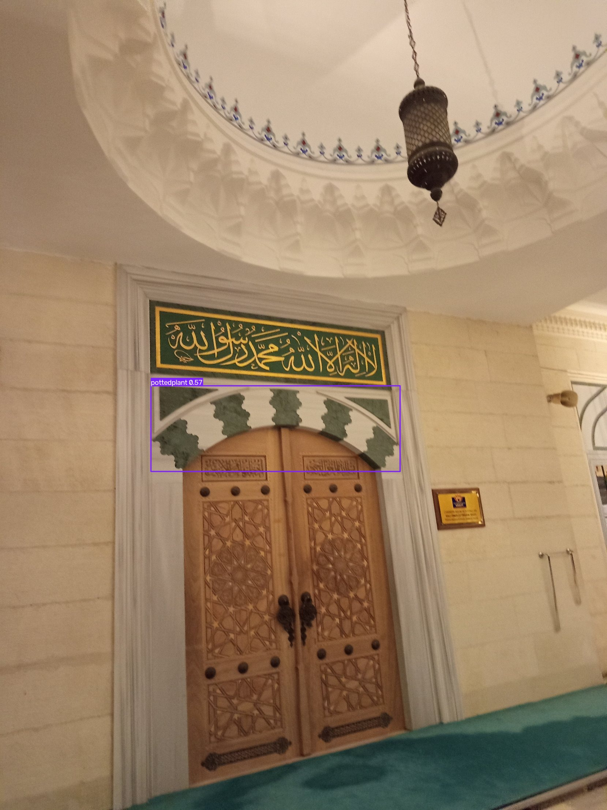

| Sınıf | Tahmin | Gerçek | Doğru | Kaçırılan | Yanlış | Ort. güven |
|---|---:|---:|---:|---:|---:|---:|
| pottedplant | 1 | 0 | 0 | 0 | 1 | 0.570 |

Tek görüntü çıkarım süresi: 19.18 ms.

### Yorumlar

Confidence eşiği tüm fotoğraflarda **0.25** olarak sabit tutuldu; fotoğraflara özel ayar yapılmadı. Gerçek sayılar fotoğraflara bakılarak elle sayılmıştır (`real_photos/ground_truth.csv`); kalabalık sahnelerde yaklaşıktır.

- **foto1.jpg — kütüphane/selfie (F1 0.35):** Ana kişi 0.94 güvenle doğru bulundu. Sol arka plandaki kırmızı tişörtlü ikinci kişi çok küçük ve uzak olduğu için kaçırıldı. Sandalyelerin yalnızca 2/6'sı bulunabildi; diğerleri masaların arkasında kısmen görünüyor ya da ana kişi tarafından kapatılıyor. Sofa ve diningtable sınıflarından hiçbir nesne bulunamadı (0/2 ve 0/3); kütüphanedeki uzun çalışma masaları ve kıvrımlı oturma bankları VOC'deki tipik yemek masası/kanepe görünümünden farklı ve kadraj kenarında kesiliyor. Sağ üstteki parlak pencere/cam panel **tvmonitor** olarak 0.50 güvenle yanlış sınıflandırıldı (dikdörtgen parlak yüzey). Precision 0.75, recall 0.23: model bulduklarında doğru, ancak kalabalık ve örtüşmeli sahnede kaçırma fazla.
- **foto2.jpg — parkta kedi ve kişi (F1 1.00):** Kişi (0.83) ve kedi (0.84) eksiksiz ve doğru bulundu. Yakın plan, net özneler ve yeterli ışık sayesinde en başarılı fotoğraf oldu. Arka plandaki 2 çok uzak insan ground truth'a dahil edilmedi; model de bunları tespit etmedi, yani sayılar tutarlı.
- **foto3.jpg — gece otopark, cam arkası (F1 0.46):** 9 arabanın 3'ü bulunabildi; precision 1.00 fakat recall 0.30. Nedeni gece çekimi, camdan yansımalar, hareket bulanıklığı ve araçların iç içe/örtüşmeli park etmesi. Kutulara bakıldığında model iç içe duran araçları ayıramamış: 0.77 güvenli büyük kutu öndeki koyu aracı ve beyaz aracı birlikte, 0.65 güvenli kutu ise kırmızı aracı ve önündeki koyu aracı birlikte kapsıyor. Bu yüzden sayıya dayalı precision (1.00) iyimserdir; kutu bazında eşleştirme yapılsaydı daha düşük çıkardı. Solda poşet taşıyan kişi hareket bulanıklığı ve karanlık nedeniyle kaçırıldı. Bu fotoğraf domain shift'in (gece, cam, düşük ışık) recall'u nasıl düşürdüğünü iyi gösteriyor.
- **foto4.jpg — gece bahçe (F1 0.80):** Diningtable 0.85 ve sandalyelerden biri 0.91 ile doğru bulundu. Sağ üstteki ikinci sandalye kadraj kenarında kısmi kaldığı ve koyu zemine karıştığı için kaçırıldı. Precision 1.00, recall 0.67. Karanlığa rağmen ana nesnelerin bulunması, modelin masa/sandalye bağlamını iyi öğrendiğini gösteriyor.
- **foto5.jpg — cami kapısı, negatif örnek (F1 tanımsız):** Ground truth'ta VOC sınıfı yok; ideal çıktı boş olmalıydı. Model kapı kemerindeki yeşil-beyaz yaprak benzeri süslemeyi **pottedplant** olarak 0.57 güvenle yanlış tespit etti. Bu, dekoratif bitki desenlerinin ve yeşil çinilerin pottedplant ile karıştırılabildiğini gösteren temiz bir false positive örneğidir. Eşik 0.25'te kaldığı için tespit listeye girdi; eşik 0.60'a çıkarılsaydı bu kutu elenirdi, ancak eşik test sonucuna göre değiştirilmedi.

**Genel değerlendirme:** Net, yakın ve iyi ışıklı öznelerde (foto2, foto4) model güvenilir; kalabalık/örtüşmeli iç mekân (foto1), gece+cam+yansıma (foto3) ve dekoratif dokulu arka planlarda (foto5) kaçırma ve yanlış pozitif artıyor. Bu durumlar eğitim dağılımındaki VOC görüntülerinden farklı ışık/kamera/örtüşme koşullarından kaynaklanıyor.

## Sınırlamalar ve Gelecek Çalışma

- Model yalnızca 20 VOC sınıfını tanır; COCO'daki truck, laptop gibi sınıflar yoktur.
- Küçük nesneler, ağır örtüşme ve düşük ışıkta recall düşer.
- Gerçek telefon fotoğrafları farklı kamera/ışık dağılımı nedeniyle domain shift yaşayabilir.
- Gelecekte daha fazla epoch, daha büyük model (s/m) veya veri artırma ile mAP artırılabilir.
- Gradio uygulaması tek görüntü işler; video için batch/stream optimizasyonu gerekir.
