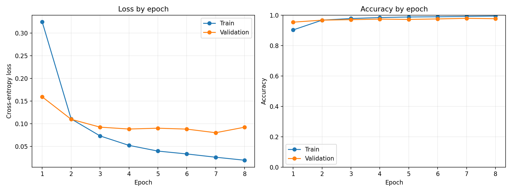
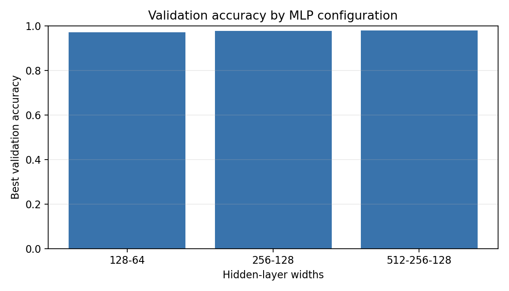
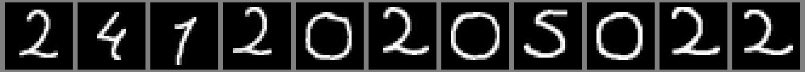

# MNIST MLP Deney Raporu

> Tum sayisal degerler `artifacts/metrics.json` ve `artifacts/handwriting_predictions.csv` dosyalarindaki gercek olcumlerden alinmistir. Otomatik uretilen ozet tablo `RESULTS.md` dosyasindadir.

## 1. Amac ve yontem

MNIST'teki 0-9 rakamlarini CNN kullanmadan, sifirdan egitilen bir MLP ile siniflandirdim. Girdi her biri 28x28 piksel olan gri tonlu goruntulerdir; goruntu `Flatten` ile 784 boyutlu vektore cevrilir. Modelde yalnizca tam baglantili (`Linear`) katmanlar ve ReLU aktivasyonu vardir. Hazir/onceden egitilmis model kullanilmamistir.

## 2. Veri ve bolme

- Veri kumesi: MNIST
- Train: 55.000 ornek
- Validation: 5.000 ornek
- Test: 10.000 ornek
- Train/validation ayrimi MNIST egitim kumesinden `random_split` ile seed 42 kullanilarak yapilmistir (tekrar uretilebilir).
- Test kumesi model egitimi, epoch secimi veya mimari secimi icin kullanilmamistir. Model ve epoch validation accuracy'ye gore secildikten sonra test kumesi yalnizca bir kez degerlendirilmistir.

## 3. Deney 1 - Hiperparametreler ve sonuclar

| Hiperparametre | Deger |
|---|---|
| Mimari | 784 -> 512 -> 256 -> 128 -> 10 (3 gizli katman) |
| Aktivasyon | ReLU |
| Kayip fonksiyonu | CrossEntropyLoss |
| Optimizer | Adam |
| Ogrenme orani | 0.001 |
| Batch size | 128 |
| Epoch sayisi | 8 (en iyi validation epoch'u secildi) |
| Normalizasyon | `ToTensor`: pikseller [0, 1] araligina olceklenir |
| Seed | 42 |
| Cihaz | CUDA (GPU) |

| Olcum (secilen epoch: 7) | Deger |
|---|---:|
| Training loss | 0.0261 |
| Validation loss | 0.0802 |
| Training accuracy | 99.14% |
| Validation accuracy | 97.86% |
| **Test accuracy** | **97.98%** |
| Test loss | 0.0715 |
| Egitim suresi (secilen model, 8 epoch) | 43.5 saniye |

Egitim sureci grafikleri:



**Yorum:** Training loss her epoch duzenli olarak azalmistir (0.325 -> 0.019). Validation loss ise 4. epoch'tan sonra 0.08-0.09 civarinda yataylasmis ve son epoch'ta 0.080'den 0.092'ye yukselmistir. Training accuracy (%99.3) ile validation accuracy (%97.6) arasindaki fark son epoch'ta acilmaya devam etmektedir. Bu, modelin egitim verisini ezberlemeye (overfitting) basladiginin isaretidir. Bu nedenle son epoch yerine validation accuracy'si en yuksek olan 7. epoch'un agirliklari secilmistir. Test accuracy'nin (%97.98) validation accuracy'ye (%97.86) cok yakin olmasi, validation kumesinin test performansini iyi temsil ettigini ve secimin test verisine bakilmadan dogru yapildigini gosterir.

## 4. Yapilandirma karsilastirmasi

`python train.py --compare` ile uc farkli gizli katman yapisi ayni hiperparametrelerle egitilmis ve yalnizca validation accuracy'ye gore karsilastirilmistir:

| Gizli katmanlar | Parametre sayisi (yaklasik) | En iyi epoch | Validation accuracy | Egitim suresi |
|---|---:|---:|---:|---:|
| 128, 64 | 109 bin | 7 | 97.08% | 41.0 sn |
| 256, 128 | 235 bin | 7 | 97.60% | 36.7 sn |
| 512, 256, 128 | 567 bin | 7 | **97.86%** | 43.5 sn |



Model kapasitesi arttikca validation accuracy artmistir, ancak kazanc giderek kuculmektedir (+0.52 puan, sonra +0.26 puan). En buyuk model en iyi validation sonucunu verdigi icin secilmis ve test kumesine yalnizca bu model uygulanmistir. Egitim sureleri GPU'da birbirine yakindir; bu boyutlarda sureyi asil belirleyen veri yukleme ve epoch sayisidir.

## 5. Kendi el yazimla yazdigim okul numarasi

Okul numarami kagida kendi el yazimla kalemle yazip fotografladim: `data/handwriting_photo/okul_numarasi.png`

Fotograftaki her rakam `prepare_photo_digits.py` ile ayri bir MNIST formatli goruntuye donusturuldu (`data/handwriting/`):

1. Gri tonlamaya cevirme.
2. Kagittaki esit olmayan isigi duzeltmek icin arka plani buyuk bir medyan filtresiyle tahmin edip goruntuyu buna bolme, ardindan esikleme.
3. Bagli bilesen analizi ile rakamlari ayirma ve soldan saga siralama.
4. Renkleri tersine cevirme: MNIST'teki gibi siyah arka plan, beyaz rakam.
5. Rakami en-boy oranini koruyarak 20x20 kutuya sigdirma ve 28x28 tuvale yerlestirme.
6. MNIST'teki gibi rakami kutle merkezine gore ortalama.
7. Tahmin sirasinda pikselleri 255'e bolerek [0, 1] araligina normalize etme (egitimdeki `ToTensor` ile ayni).



Tahminler (`artifacts/handwriting_predictions.csv`):

| Sira | Gercek | Tahmin | Guven | Dogru mu |
|---:|:---:|:---:|---:|:---:|
| 1 | 2 | 2 | 99.9% | Evet |
| 2 | 4 | 4 | 99.8% | Evet |
| 3 | 1 | 7 | 98.9% | **Hayir** |
| 4 | 2 | 2 | 100.0% | Evet |
| 5 | 0 | 0 | 98.2% | Evet |
| 6 | 2 | 2 | 100.0% | Evet |
| 7 | 0 | 0 | 99.1% | Evet |
| 8 | 5 | 5 | 99.9% | Evet |
| 9 | 0 | 0 | 99.7% | Evet |
| 10 | 2 | 2 | 100.0% | Evet |
| 11 | 2 | 2 | 100.0% | Evet |

- Dogru tahmin edilen rakam sayisi / toplam rakam sayisi: **10 / 11 (%90.91)**
- MNIST test basarisi ile el yazisi basarisi arasindaki fark: %97.98 - %90.91 = **yaklasik 7 puan**. Ornek sayisi yalnizca 11 oldugundan tek bir hata basariyi 9 puan dusurur; bu nedenle bu oran kaba bir gostergedir.
- Muhtemel nedenler:
  - **Yazim bicimi:** Yanlis tahmin edilen "1" rakamim egik ve ust ucunda kucuk bir kanca var. MNIST'teki "1"lerin cogu duz bir cizgidir; kancali ve egik bir cizgi ise MNIST'teki "7"lere daha cok benzer. Model bu hatayi %98.9 guvenle yapmistir. Yani egitim dagilimi disindaki bir ornekte model yanlis olsa bile cok emin olabilir.
  - **Kalem kalinligi ve kontrast:** Ince tukenmez kalem cizgisi kucultulunce MNIST'teki kalin, yumusak kenarli cizgilerden daha ince kalmaktadir.
  - **Hizalama/olcekleme:** Gelistirme sirasinda rakamlari yalnizca sinirlayici kutunun ortasina yerlestirdigimde 11 rakamdan 8'i dogru tahmin edildi. MNIST'in kullandigi kutle merkezi ortalamasina gecince 10'u dogru tahmin edildi. Bu fark, MLP'nin her pikseli ayri bir girdi olarak gordugunu ve kaymaya (translation) karsi duyarli oldugunu gosterir; CNN'deki gibi konumdan bagimsiz ozellik cikarimi yoktur.
  - **Veri dagilimi farki (distribution shift):** Fotograf, kagit dokusu, isik farki ve benim yazim stilim MNIST'i olusturan yazarlarin stilinden farklidir.

## 6. Genel degerlendirme

- MLP, CNN kullanilmadan MNIST'te yaklasik %98 test basarisina ulasmistir. Iki ve uc gizli katmanli yapilar karsilastirildiginda daha genis/derin model biraz daha iyi sonuc vermis, ancak kazanc azalarak artmistir.
- Train/validation egrileri, 4-5. epoch'tan sonra modelin hafifce ezberlemeye basladigini gostermektedir. Validation'a gore en iyi epoch'u secmek (erken durdurmaya benzer) bu etkiyi sinirlamistir. Dropout, weight decay veya veri artirma (kucuk kaydirma/dondurme) ile genelleme daha da iyilestirilebilir.
- Validation ve test sonuclarinin birbirine cok yakin olmasi, ayni dagilimdan gelen verilerde modelin iyi genellestigini gosterir. Kendi el yazimda basarinin %90.91'e dusmesi ise **egitim verisi ile gercek dunya verisi arasindaki dagilim farkini** gozlemledigim noktadir.
- En onemli ders, gercek dunya verisinde basarinin yalnizca modele degil, **on islemenin egitim verisine ne kadar benzedigine** de bagli olmasidir. Renk tersleme, 20x20 olcekleme, kutle merkezine gore ortalama ve [0, 1] normalizasyonu MNIST ile ayni yapilmadan model kendi el yazimda belirgin sekilde kotu sonuc vermistir.
- MLP goruntunun uzaysal yapisini kullanmadigi icin konum ve stil degisikliklerine CNN'e gore daha hassastir. Bu odevde CNN kullanilmasi yasak oldugundan bu siniri, on isleme ile girdiyi MNIST formatina mumkun oldugunca yaklastirarak azalttim.

## Calistirma ozeti

```bash
python -m pip install -r requirements.txt
python train.py --compare                       # egitim + karsilastirma, RESULTS.md ve grafikler
python prepare_photo_digits.py data/handwriting_photo/okul_numarasi.png --labels <okul_numarasi>
python predict_handwriting.py                   # el yazisi tahminleri
python -m unittest discover -s tests -v
```
